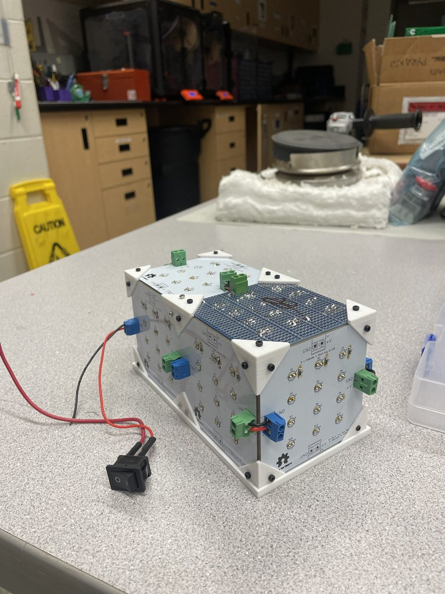
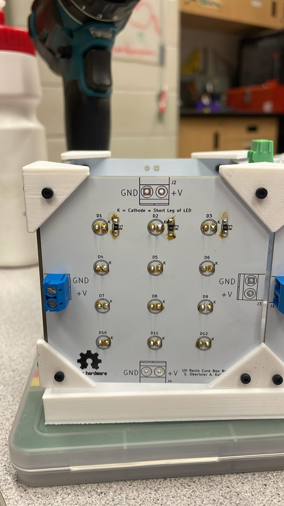

# panel-cube-joints

Parametric OpenSCAD connectors that join square panels, such as circuit
boards, into boxes. Each connector is built from right-triangle plates, one
per panel it holds, with a ledge that the panel's edge seats against and one
screw hole per plate. A tray holds the finished box.

## Connectors

All four are in `connectors.scad`:

| Module | Joins | Plates |
| --- | --- | --- |
| `edge_connector` | two panels side by side in one plane | 2 |
| `corner_connector` | two panels at 90 degrees, along a vertical edge | 2 |
| `sleeve_connector` | two panels in one plane and the two at 90 degrees to them, along an edge | 4 |
| `sleeve_corner_connector` | three panels at a corner | 3 |

Their parameters:

| Parameter | What it sets |
| --- | --- |
| `dim` | leg length of each triangular plate |
| `thickness` | plate thickness |
| `plate_thickness` | width of the ledge the panel seats against |
| `hole_dia` | screw hole diameter |
| `hole_loc` | screw hole position on each plate, from its right-angle corner |

Place the holes to match the panel's own holes. With the panel seated against
the ledge, a hole 5 mm in from each panel edge sits at
`[5 + plate_thickness, 5 + plate_thickness]` on corner pieces. On the edge and
sleeve pieces it sits at `[5, 5 + plate_thickness]`: the first coordinate is
measured from the seam between the two panels.

## Screws

`hole_dia = 1.7` is a pilot for M2 screws to tap into the printed plastic,
with no nuts. This size has not been test-printed yet: print one connector and
drive an M2 into it before printing a set, and adjust `hole_dia` for your
printer and material. For a screw and nut instead, use 2.2-2.4 mm to clear
the M2.

The first set of connectors, printed in 2025, had five-sided holes about
1.78 mm across inside, not the 2.2 mm round ones the code asked for.
`connectors.scad` set `$fn` at its top level, which does not apply to files
that `use` it, so OpenSCAD drew each hole with its default five sides. The M2
screws tapped into those, but a few were loose and needed nuts. The facet
count is now set on the hole itself.

## Tray

`base_shell` in `base_shell.scad` is an open tray for a row of `cube_count`
cubes, sized from the panel, connector and ledge thicknesses plus
`fit_allowance` on each side. `wall_thickness`, `floor_thickness` and `height`
set the tray's walls, floor and overall height.

## Example: a two-cube box

`examples/example_two_cube_box.scad` lays out every part of the box in the
photos, ready to print. Set `part` to `"connectors"` or `"tray"` to export
them separately.

The box is two 80 mm cubes end to end, 160 x 80 x 80 mm:

- two panels on each long side and one on each end
- two panels on top, as a lid that lifts off
- the box stands in the tray

It takes 12 connectors, 32 M2 screws (one per plate) and one tray:

| Connector | Where | Count | Screws |
| --- | --- | --- | --- |
| sleeve-corner | top corners | 4 | 12 |
| corner | bottom corners, into the tray | 4 | 8 |
| sleeve | top edge, where the two top panels meet | 2 | 8 |
| edge | bottom of each long side, where its two panels meet | 2 | 4 |

The parameters are the ones the box in the photos was printed with:

- `dim = 20`, `thickness = 2`, `plate_thickness = 1.4`
- holes 5 mm in from the panel edges
- a tray with 1.6 mm walls, a 1.2 mm floor, 4.8 mm tall, with 0.8 mm fit

The exception is the new 1.7 mm pilot holes, described under Screws.

## Other files

- `examples/example_connectors.scad`: one of each connector
- `examples/example_base_shell_simple.scad`: the two-cube tray on its own
- `cube_cluster.scad` and `examples/example_cube_cluster.scad`: shows which
  faces of a cluster of cubes are exposed, for planning a box. It draws
  panels only, not connectors.

## License

MIT, see [LICENSE](LICENSE).
